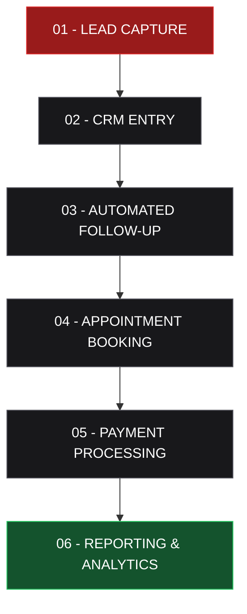
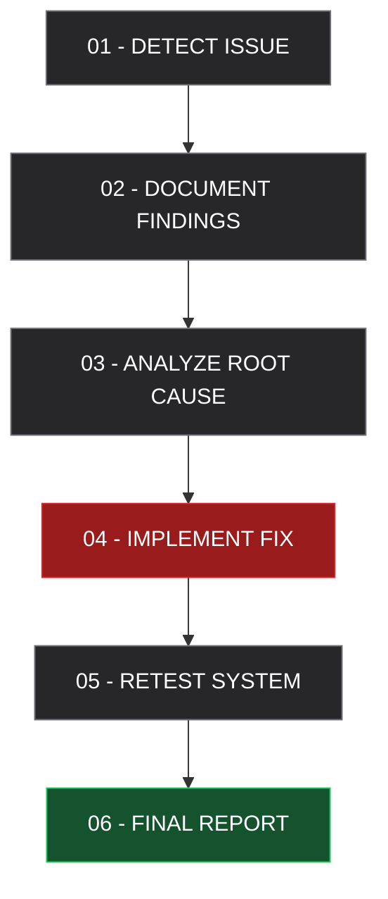

  

# GOHIGHLEVEL
# SYSTEM AUDIT FRAMEWORK

### DIAGNOSE. OPTIMIZE. AUTOMATE. SCALE.

A comprehensive technical inspection framework for identifying system failures, eliminating automation bottlenecks, and improving operational performance inside GoHighLevel.

 

  

<a href="https://adnanjameelautomation.netlify.app/">PORTFOLIO</a>
&nbsp; ◆ &nbsp;
<a href="https://www.linkedin.com/in/adnanjameel091">LINKEDIN</a>
&nbsp; ◆ &nbsp;
<a href="https://www.upwork.com/freelancers/~01b36b5436c42666b9">UPWORK</a>

  

---

## ◈ 00 — PROJECT OVERVIEW

**Your GoHighLevel system is only as strong as its weakest component.**

A broken trigger, incorrect CRM configuration, failed webhook, or missed follow-up can create problems throughout the entire customer journey.

This framework provides a structured way to inspect, document, and prioritize technical issues across your GoHighLevel ecosystem.

| PROJECT ATTRIBUTE | DETAILS |
|:---|:---|
| Platform | GoHighLevel |
| Category | CRM & Marketing Automation |
| Framework | Technical System Audit |
| Coverage | 9 Core Areas |
| Inspection Points | 51 Technical Checks |
| Focus | Performance, Reliability & Optimization |
| Created By | Adnan Jameel |

---

## ◈ 01 — AUDIT COMMAND CENTER

| 09 | 51 | 05 |
|:---:|:---:|:---:|
| **AUDIT DOMAINS** | **INSPECTION POINTS** | **PRIORITY STAGES** |

### SYSTEM COVERAGE

| MODULE | SYSTEM | INSPECTION OBJECTIVE |
|:---:|---|---|
| 01 | Funnel Infrastructure | Lead capture & conversion |
| 02 | Website Architecture | Domains, SSL & responsiveness |
| 03 | Automation Engine | Triggers, logic & execution |
| 04 | CRM Architecture | Contacts, pipelines & data |
| 05 | Booking Infrastructure | Calendars & scheduling |
| 06 | Communication Systems | Email, SMS & deliverability |
| 07 | API Infrastructure | Integrations & webhooks |
| 08 | Payment Infrastructure | Checkout & memberships |
| 09 | Analytics Engine | Attribution & reporting |

---

## ◈ 02 — SYSTEM ARCHITECTURE

### THE CUSTOMER JOURNEY

Every stage must work correctly before the next stage can deliver its full value.

> [!IMPORTANT]
> **CORE PRINCIPLE:** Fix lead capture, CRM synchronization, and follow-up failures before optimizing secondary operations. Revenue-critical failures always deserve priority.

---

## ◈ 03 — TECHNICAL INSPECTION

**51 INSPECTION POINTS ACROSS 9 OPERATIONAL MODULES.**

Use the expandable sections to inspect each system independently.

### 01 / FUNNEL INFRASTRUCTURE

<strong>INSPECT FUNNEL SYSTEM — 06 CHECKS</strong>

**Conversion & Lead Capture**

- [ ] Every funnel step loads and connects to the next step.
- [ ] Forms submit and create or update contacts correctly.
- [ ] Redirects and thank-you pages work correctly.
- [ ] Tracking pixels and analytics fire correctly.
- [ ] Pages render correctly on mobile and desktop.
- [ ] Page speed is optimized.

### 02 / WEBSITE ARCHITECTURE

<strong>INSPECT WEBSITE SYSTEM — 06 CHECKS</strong>

**Domain & Frontend Configuration**

- [ ] Domain and DNS records are connected and verified.
- [ ] SSL is active across all pages.
- [ ] Forms and chat widgets connect to the CRM.
- [ ] Navigation, buttons, and links work correctly.
- [ ] Mobile layouts have no broken sections.
- [ ] Page titles and meta descriptions are configured.

### 03 / AUTOMATION ENGINE

<strong>INSPECT WORKFLOW ENGINE — 07 CHECKS</strong>

**Workflow Logic & Execution**

- [ ] Triggers execute under the correct conditions.
- [ ] No workflow stops unexpectedly or enters an infinite loop.
- [ ] If/Else conditions and branching logic are accurate.
- [ ] Duplicate emails and SMS messages are prevented.
- [ ] Wait steps and sending windows match business hours.
- [ ] Unused workflows are paused or removed.
- [ ] Every workflow has a clear naming convention and folder.

### 04 / CRM ARCHITECTURE

<strong>INSPECT CRM SYSTEM — 06 CHECKS</strong>

**Contact Data & Pipeline Management**

- [ ] Pipeline stages reflect the actual sales process.
- [ ] Opportunities move between stages automatically where appropriate.
- [ ] Tags follow consistent naming conventions.
- [ ] Custom fields are configured correctly.
- [ ] Duplicate contacts are identified and merged.
- [ ] Smart Lists return the correct contacts.

### 05 / BOOKING INFRASTRUCTURE

<strong>INSPECT CALENDAR SYSTEM — 06 CHECKS</strong>

**Appointments & Scheduling**

- [ ] Availability and booking buffers are configured correctly.
- [ ] Double bookings are prevented.
- [ ] Confirmation and reminder messages send on time.
- [ ] No-show and rescheduling automations work.
- [ ] Round-robin assignments are accurate.
- [ ] Google Calendar and Outlook synchronization works.

### 06 / COMMUNICATION SYSTEMS

<strong>INSPECT EMAIL & SMS — 06 CHECKS</strong>

**Deliverability & Messaging Compliance**

- [ ] Sending domain has valid SPF, DKIM, and DMARC records.
- [ ] A2P registration is approved for applicable SMS campaigns.
- [ ] Emails reach inboxes rather than spam folders.
- [ ] Unsubscribe and opt-out mechanisms are configured.
- [ ] Templates contain working links and correct merge fields.
- [ ] Failed and blocked messages are investigated.

### 07 / API & INTEGRATION INFRASTRUCTURE

<strong>INSPECT INTEGRATION ENGINE — 05 CHECKS</strong>

**External Connections & Data Exchange**

- [ ] Zapier, n8n, and Make scenarios execute without errors.
- [ ] Webhooks return expected success responses.
- [ ] API keys and tokens are valid and stored securely.
- [ ] Google Sheets, Calendar, and Gmail synchronization is accurate.
- [ ] Failed executions have an alert or retry mechanism.

### 08 / PAYMENT INFRASTRUCTURE

<strong>INSPECT PAYMENT SYSTEM — 05 CHECKS</strong>

**Transactions & Membership Access**

- [ ] Checkout completes successfully from start to finish.
- [ ] Stripe is connected and test payments pass.
- [ ] Invoices and receipts are generated automatically.
- [ ] Course and membership access is granted after payment.
- [ ] Failed payment and refund processes are handled correctly.

### 09 / ANALYTICS ENGINE

<strong>INSPECT REPORTING SYSTEM — 04 CHECKS</strong>

**Performance & Business Intelligence**

- [ ] Dashboards accurately show lead acquisition sources.
- [ ] Lead source and UTM parameters are captured.
- [ ] Pipeline value and conversion rates are visible.
- [ ] Reports reflect actual business performance metrics.

---

## ◈ 04 — FAILURE PRIORITIZATION

Not all failures have the same business impact.

Classify every finding before implementing a fix.

| LEVEL | SEVERITY | RESPONSE |
|:---:|---|---|
| P0 | 🔴 Critical | Immediate investigation |
| P1 | 🟠 High | Prioritize corrective action |
| P2 | 🟡 Medium | Schedule optimization |
| P3 | 🟢 Low | Routine maintenance |

### RECOMMENDED RESOLUTION WORKFLOW

---

## ◈ 05 — AUDIT REPORT TEMPLATE

Use this structure to document technical findings.

| FIELD | DESCRIPTION |
|---|---|
| Audit Area | Affected system or module |
| Issue | Description of the failure |
| Severity | P0, P1, P2 or P3 |
| Root Cause | Why the issue occurred |
| Business Impact | Operational or revenue impact |
| Corrective Action | Required solution |
| Verification | Retest and validation result |

### FINAL ASSESSMENT

| STATUS | CONDITION | ACTION |
|:---:|---|---|
| 🟢 HEALTHY | Most checks pass | Maintain and monitor |
| 🟡 WARNING | Multiple failures | Targeted optimization |
| 🔴 CRITICAL | Widespread failures | Comprehensive repair |

---

## ◈ 06 — EXECUTION PROTOCOL

A structured implementation process:

1. Inspect all nine operational modules.
2. Identify and document failed checks.
3. Assign severity to each issue.
4. Investigate root causes.
5. Implement corrective actions.
6. Retest affected systems.
7. Prepare the final technical report.

---

## ◈ 07 — RELATED PROJECTS

**EXPLORE MORE OF MY GOHIGHLEVEL AUTOMATION WORK.**

[GHl AUTOMATION EXAMPLES →](https://github.com/adnanjameel-ghl/ghl-automation-examples)

Discover practical automation concepts, workflow structures, and integration examples.

---

# LET'S ENGINEER BETTER SYSTEMS.

### AUTOMATION ISN'T JUST ABOUT WORKFLOWS.
### IT'S ABOUT BUILDING SYSTEMS THAT PERFORM.

I help agencies and businesses build, audit, optimize, and scale their GoHighLevel ecosystems.

 

  

**ADNAN JAMEEL**

GoHighLevel Expert · AI Automation Specialist

2+ Years Hands-on Experience

*Flexible working hours with full overlap for US and UK time zones.*

 

DESIGNED WITH PRECISION · ENGINEERED FOR PERFORMANCE

